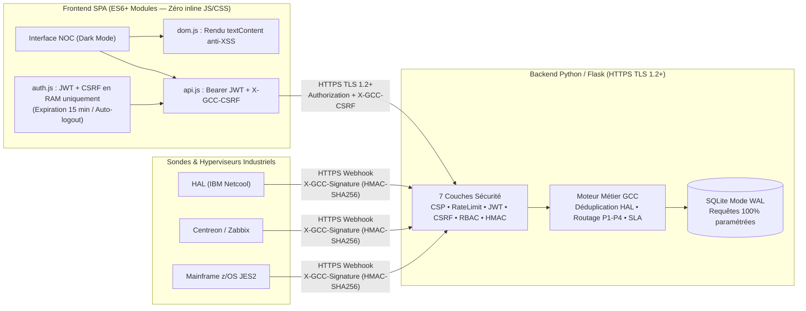
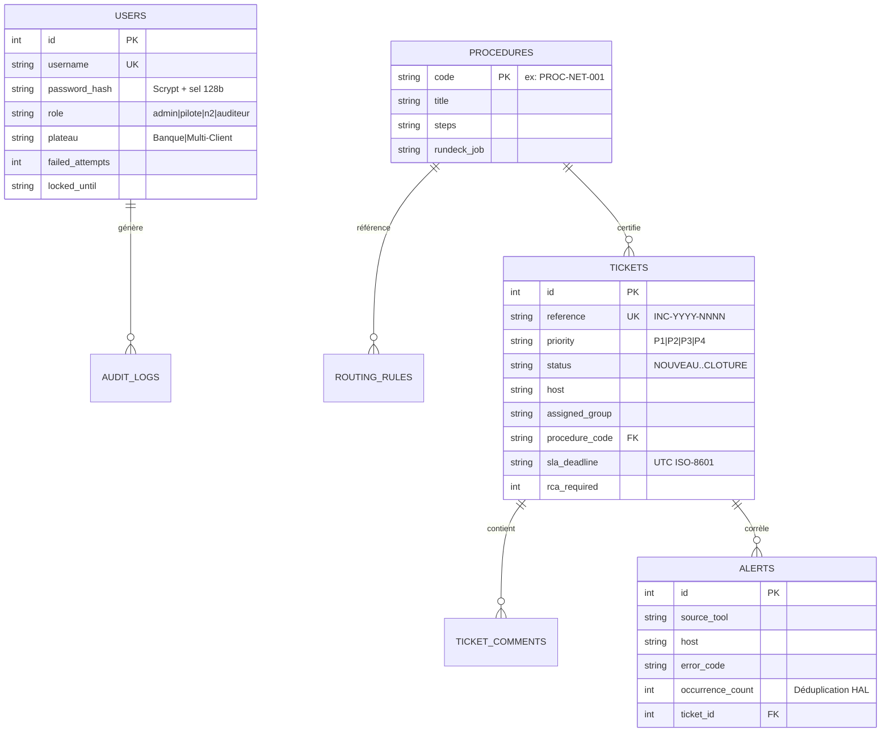
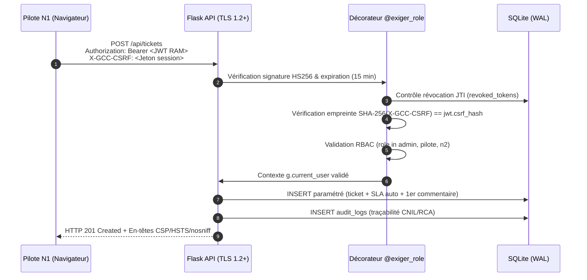

# Architecture Technique & Sécurité — Application de Supervision GCC

Ce document formalise les 4 vues architecturales majeures de la plateforme de supervision GCC, conçue selon le principe de **défense en profondeur** (ANSSI RGS 2.0, Guide d'Hygiène Informatique et recommandations CNIL).

---

## 1. Architecture Globale Frontend / Backend

---

## 2. Schéma de Base de Données Relationnelle (SQLite WAL)

---

## 3. Cycle de Vie d'une Requête Mutante (`POST /api/tickets`)

---

## 4. Modèle de Défense en Profondeur (7 Couches)

| Couche | Contrôle technique | Menace neutralisée | Référentiel |
|---|---|---|---|
| **1. Transport** | `SSLContext` TLS 1.2+ (`ECDHE+AESGCM`), HSTS | Écoute réseau / MITM / downgrade | ANSSI RGS 2.0 |
| **2. En-têtes HTTP** | CSP stricte (`script-src 'self'`, `style-src 'self'`), `DENY`, `nosniff` | XSS, Clickjacking, MIME sniffing | ANSSI Hygiène |
| **3. Anti brute-force** | Rate Limiter fenêtre glissante (5 essais / 5 min) + verrouillage compte | Force brute & saturation | CNIL |
| **4. Session & Auth** | Scrypt + JWT HS256 verrouillé en **RAM uniquement** (TTL 15 min) + révocation JTI | Vol de jeton XSS (`localStorage`), rejeu | CNIL / ANSSI |
| **5. Anti-CSRF / HMAC** | En-tête `X-GCC-CSRF` lié au JWT ; webhooks isolés signés `X-GCC-Signature` | Cross-Site Request Forgery, spoofing sonde | OWASP / ANSSI |
| **6. Contrôle RBAC** | Décorateur `@exiger_role("admin", "pilote")` systématique | Élévation de privilèges horizontale/verticale | Moindre privilège |
| **7. Persistance** | SQLite WAL + requêtes 100% paramétrées + `audit_logs` + Docker non-root | Injection SQL, corruption concurrente, non-répudiation | ANSSI / RCA |
